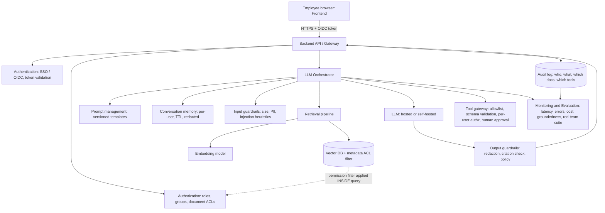

# Secure Enterprise Document Chatbot: Architecture (Assignment 2, Question 2)

Hypothetical system: employees ask questions about internal documents; the chatbot retrieves
relevant passages and may call approved tools. **This is a design, not implemented code.**

## Components

| Component | Responsibility |
|---|---|
| Frontend | Chat UI; shows citations; never holds secrets; renders model output as text (no raw HTML) |
| Backend API | Single entry point; rate limiting; request size limits; session handling |
| Authentication | Corporate SSO (OIDC); short-lived tokens; identity passed to every downstream call |
| Authorization | Decides what *this user* may read or do (RBAC/ABAC); evaluated by code, not by the model |
| LLM orchestration | Builds prompts, runs retrieval, calls the LLM, executes approved tool calls, loops with step limits |
| Prompt management | Versioned prompts in source control; system prompt separated from untrusted content |
| Embedding model | Turns chunks and queries into vectors (same model for both) |
| Vector database | Stores chunk vectors + metadata (doc id, ACL groups, sensitivity, source version) |
| Retrieval pipeline | Embed query -> filtered top-k -> optional rerank -> re-check ACL -> assemble context |
| Conversation memory | Recent turns per user and session; expires; stores redacted text; never shared across users |
| Tool calling | Only through a gateway that enforces allowlist, argument schema, user permission, rate limits |
| Guardrails | Input and output checks (see `ai-security.md`) |
| Logging | Append-only audit trail of requests, retrieved doc ids, tool calls, decisions (no raw secrets) |
| Evaluation | Offline test sets: retrieval recall, answer groundedness, plus an adversarial prompt-injection suite run in CI |
| Monitoring | Latency, error rates, token cost, refusal/guardrail-hit rates, anomaly alerts |

## Request lifecycle

1. User sends a question; frontend calls the backend over HTTPS with the SSO token.
2. Backend **authenticates** the token and loads the user's identity and groups.
3. Rate limit and size checks run; the request is logged with a request id.
4. Input guardrails: length limit, PII/secret detection, injection heuristics (probabilistic: used for signals, not as the only gate).
5. Orchestrator loads recent **memory** for this user and session.
6. Query is embedded; the **vector search runs with a permission filter** (user's groups) in the query itself.
7. Retrieved chunks are re-checked against the authorization service (defence in depth) and trimmed to a token budget.
8. Prompt is assembled from the versioned template: system rules, then clearly delimited *untrusted* retrieved text, then the user question.
9. LLM generates an answer and may request a **tool call**.
10. Tool gateway validates: tool is on the allowlist, arguments match the schema, *the user* may use it with those arguments; high-impact tools wait for **human approval**. Results are treated as untrusted data and go back to the model; a maximum step count bounds the loop.
11. Output guardrails: redact secrets/PII, verify citations point to retrieved docs, block disallowed content.
12. Response goes to the user with citations; memory is updated with the redacted turn.
13. Audit log records user, question hash, document ids, tool calls, guardrail decisions; monitoring updates metrics; sampled interactions feed evaluation.

## Trade-offs
* Re-checking ACLs after retrieval costs a little latency but removes reliance on index-time metadata being perfectly in sync.
* Strict tool gateways reduce agent flexibility; that is intentional for an enterprise setting.
